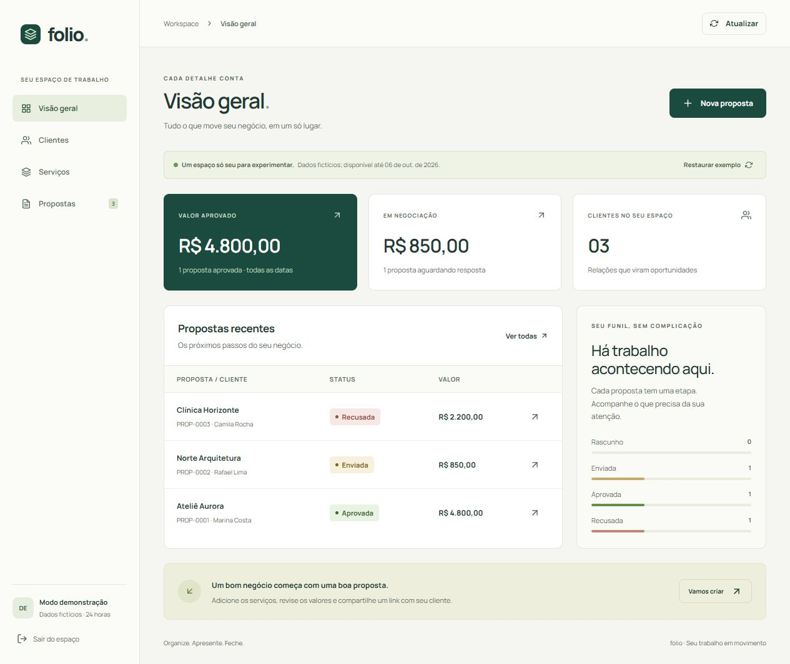
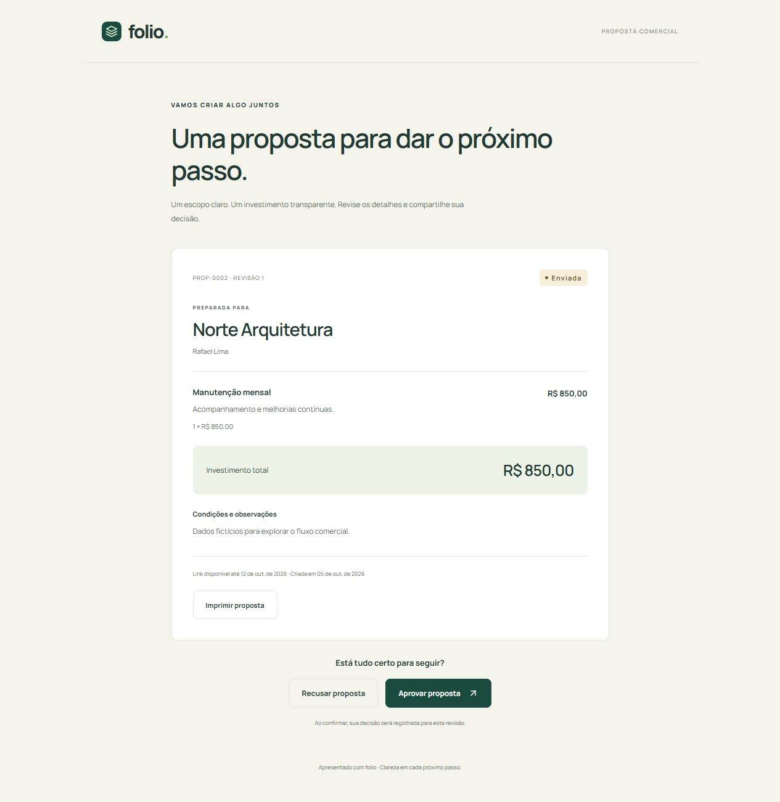
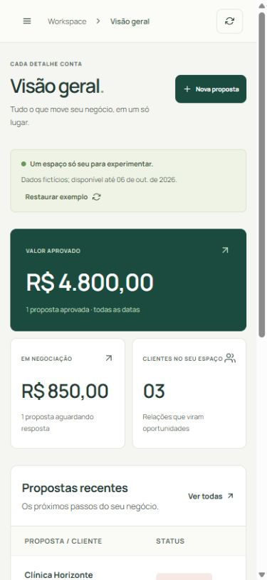

# Folio — Da proposta ao próximo negócio

**Descrição para o card:** CRM comercial com clientes, catálogo e propostas versionadas. Um fluxo completo de criação, compartilhamento e decisão, com persistência e isolamento de dados.

**Tecnologias:** React · Express · MongoDB · Playwright.

## Problema

A demonstração anterior armazenava dados no navegador. O autor conseguia abrir uma proposta, mas o endereço compartilhado não levava os dados para outro contexto. O produto precisava transformar esse percurso em uma experiência verificável.

## Solução

Uma aplicação com workspace próprio para cada visitante, clientes e catálogo organizados, propostas com snapshots e um link externo para a decisão do cliente. O painel mostra valores derivados das propostas, sem indicadores de resultado inventados.

## Decisões que merecem destaque

- **Dinheiro em centavos:** a API calcula o total e rejeita valores/quantidades inválidos.
- **Documento estável:** editar o catálogo não muda uma proposta enviada. Uma alteração cria nova revisão e encerra o link antigo.
- **Compartilhamento controlado:** token aleatório, hash no banco, validade e revogação; a página externa não expõe o painel nem contatos internos.
- **Persistência e concorrência:** MongoDB com gravação journaled e atualização condicionada pela versão, protegendo contra sobrescrita entre abas.
- **Demonstração reproduzível:** dados fictícios identificados e restauráveis, sem um visitante alterar o espaço de outro.

## Experiência

O produto usa fundo claro, verde profundo e uma hierarquia que prioriza leitura. O portfólio pode manter a direção escura escolhida e usar essas capturas como contraste. A navegação móvel se recolhe; formulários mantêm labels, mensagens e foco; o documento pode ser impresso.

## Evidência técnica

15 testes de regras/API/persistência e 5 testes em navegador passaram. O fluxo de aceite foi executado em um contexto separado; o banco foi reiniciado para verificar a permanência dos dados. Build, lint, formatação e auditoria de dependências passaram. Consulte [VALIDACAO.md](VALIDACAO.md).

Esses números demonstram verificação técnica. Não representam receita, conversão, clientes reais ou uso em produção.

## Como mostrar no portfólio

Card com captura do painel, título e uma frase de problema resolvido. Na página do case, apresentar nesta ordem: contexto, fluxo de 60 segundos, capturas desktop/mobile, três decisões técnicas e evidências. Os botões “Abrir demonstração” e “Ver código” devem apontar para a versão publicada e revisada quando ela existir. Enquanto a branch for local, marcar o case como “Em preparação”.

## Próximo marco

Publicar essa versão com backend e banco persistente, verificar a URL HTTPS e só então disponibilizar a demonstração no portfólio.
